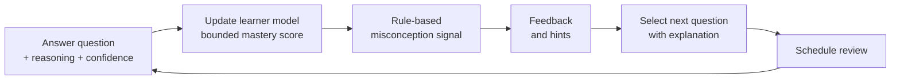

<div align="center">

# 🔁 Skill-gainner AI

### Concept-level adaptive learning, running entirely in your browser

*Every answer updates a local learner model, informs reasoning feedback, and helps choose the next practice question and review.*

<br />


[Quick Start](#-quick-start) · [Screenshots](#️-screenshots) · [How It Works](#-how-it-works) · [Demo](#-three-minute-demo) · [Features](#-features) · [Limitations](#-limitations) · [Deploy](#-deploy)

</div>

---

## 📖 Overview

**MasteryLoop AI** is a frontend-only prototype that shows how concept-level adaptive learning can work without servers or hosted AI. Learners answer practice questions, explain their reasoning, and rate their confidence. The app then updates a transparent learner model, flags possible misconceptions, explains why it picked the next question, and schedules review.

Everything runs locally in the browser: there is **no backend, API proxy, database server, or authentication service**.

---

## 🖼️ Screenshots

<table>
  <tr>
    <td align="center" colspan="2">
      
      <br /><sub><b>Landing page</b>: live learner model preview and instant demo</sub>
    </td>
  </tr>
  <tr>
    <td align="center" width="50%">
      
      <br /><sub><b>Learning overview</b>: mastery, focus areas, and reviews due</sub>
    </td>
    <td align="center" width="50%">
      
      <br /><sub><b>Progress</b>: mastery trend and concept breakdown</sub>
    </td>
  </tr>
</table>

---

## 🔄 How It Works



Each loop weighs **correctness, difficulty, confidence, reasoning detail, and repeated evidence**, so a single lucky guess or a single slip never swings mastery too far.

---

## 🚀 Quick Start

**Requirements:** Node.js 20 or later and npm.

```bash
npm install
npm run dev
```

Vite prints the local URL, usually <http://localhost:5173>.

---

## 🎬 Three-Minute Demo

| Step | Action | What to show |
|:---:|---|---|
| 1 | Open the landing page → **Start learning → Student demo** | Instant demo, no signup |
| 2 | Review the dashboard | Ohm's law flagged as a low-evidence concept; sample learner data is clearly labeled |
| 3 | Open **Adaptive practice**, pick a wrong answer, and write reasoning such as *"the resistor uses up some current"* | Submit with a confidence level |
| 4 | Read the result | Mastery update plus a possible misconception signal (deterministic rules, **not** an LLM diagnosis) |
| 5 | Choose **Next question** | The learner-model selection panel explaining the choice |
| 6 | Open **Revision** | The review scheduled after the incorrect response |
| 7 | Select **Classroom analytics** | Fictional classroom heatmap and teaching priority |
| 8 | Use the profile menu | Reset local demo progress |

---

## ✨ Features

| | Feature | Description |
|:---:|---|---|
| ⚡ | **Instant demos** | Student and teacher demos with no signup |
| 💾 | **Local persistence** | Demo learner data lives in LocalStorage and can be reset anytime |
| 🗺️ | **Concept map** | Twelve nodes across selected Class 10 Physics topics, with an interactive prerequisite map |
| 🩺 | **Diagnostic flow** | Eight questions that update concept estimates |
| 🎯 | **Adaptive practice** | Difficulty, confidence, written reasoning, hints, feedback, and an explanation of why the next question was chosen |
| 📈 | **Bounded mastery update** | Weighs correctness, difficulty, confidence, reasoning detail, and repeated evidence |
| 🧩 | **Misconception signals** | Rule-based matching with response evidence and cautious uncertainty wording |
| 🔔 | **Review and analytics** | Local review scheduling, progress views, and simulated teacher analytics |
| ♿ | **Accessible by design** | Responsive layout, keyboard-operable concept map nodes, visible focus, and reduced-motion support |

---

## 🤖 AI and Data Status

| Area | Status |
|---|---|
| Hosted AI (Gemini and others) | ❌ Not integrated. No API key is needed or accepted |
| Core logic | ✅ Deterministic and local to the browser |
| Student progress | 💾 Stored in this browser's LocalStorage |
| Classroom data | 🎭 Fictional, simulated names and scores |
| Syllabus coverage | 📚 Illustrative. Check it against the current board syllabus before classroom use |

---

## ⚠️ Limitations

> **Prototype notice:** Mastery scores and review timing are transparent heuristics, not scientifically validated measurements.

This prototype has no account system, server storage, multi-user sync, or validated assessment model. Misconception matching is a narrow rules engine and should not be treated as a diagnosis.

---

## 🌐 Deploy

```bash
npm run build
```

Publish the generated `dist/` directory on Vercel or any other static host. **No environment variables are required.**

---

<div align="center">

Built as a hackathon prototype · Frontend only · No data leaves your browser

</div>
